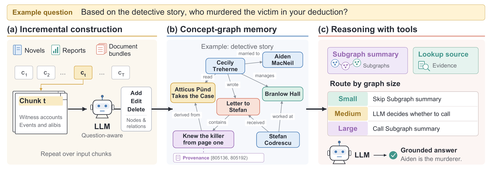

  
  
We introduce <strong>WholeReason</strong>, a 327-question benchmark that isolates long-context questions requiring both broad reading and deep multi-step reasoning, and <strong>MindGraph</strong>, a working memory that incrementally builds a question-guided concept graph whose nodes are grounded in source spans. MindGraph outperforms five strong baselines, including full-context prompting and recent memory and agent methods, while its longest LLM call reads only about 22% of the input.

